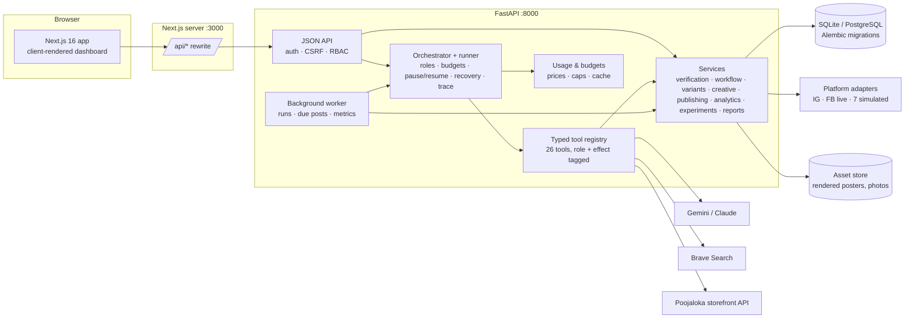
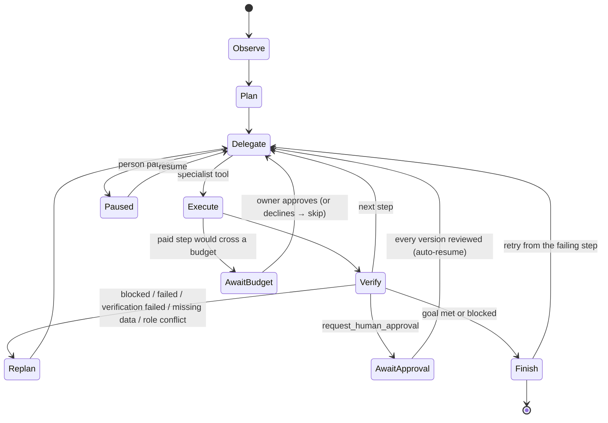
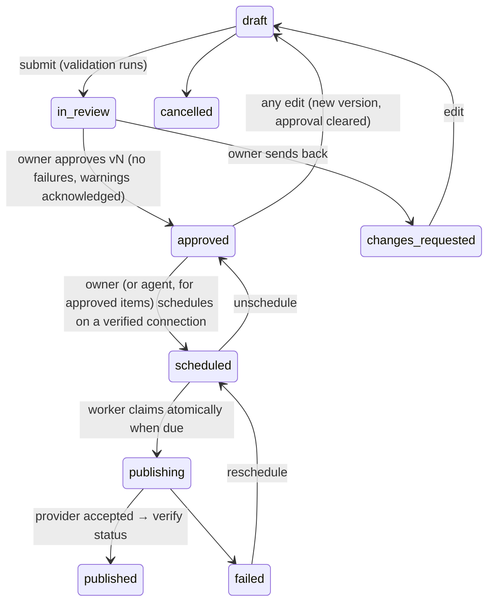

# Architecture

## Overview

* **One origin for the browser.** The frontend calls `/api/*` on its own origin; Next.js rewrites it to FastAPI.
  The session cookie stays HttpOnly and SameSite=Lax, with no CORS.
* **Backend owns all logic and secrets.** The frontend never sees credentials or tokens.
* **Worker.** A database-backed queue: agent runs and due publications are claimed with atomic `UPDATE … WHERE
  status=…`, so several workers can run safely. It runs in-process by default, or as `make worker`. Redis is
  optional and not required.

## Demo vs live separation

| | Demo | Live |
|---|---|---|
| Orchestrator | `DemoPlanner` (deterministic state machine) | `LLMPlanner` (Gemini or Claude tool use) |
| Generation | `DemoGenerator` (catalogue + brand-content templates) | `LLMGenerator` (role-specific structured outputs) |
| Catalogue | bundled Poojaloka snapshot (real, dated) | live Poojaloka storefront API |
| Research | brand's festival pages + calendar + labelled fixtures | Brave Search (parallel, cached) + public page fetch |
| Images | local Pillow renderer | same + optional Gemini background |
| Publishing adapters | `demo_<platform>` for all seven (simulated) | `instagram`, `facebook`, `webhook` |
| Metrics | synthetic, labelled | platform APIs or manual entry |
| Database | `data/demo.db` | `data/live.db` / `DATABASE_URL` |

The adapter registry exposes only mock adapters in demo mode and only real ones in live mode. Each database is
stamped with its mode on first use (`app_meta.mode`), and the app refuses a mismatch. Every fixture row carries
`is_synthetic`, every mock tool result carries `is_mock`, and the UI labels both.

## Agent

**Orchestrator and specialists.** The orchestrator (demo state machine or LLM) delegates each phase to one of six
roles. Every tool belongs to a role and declares its side effects (`read_only`, `local_write`, `cost`,
`external_read`, `external_write`, `public_publish`); the trace records both, plus a "delegate" event whenever the
active role changes. Roles share one context: the run's frozen brand snapshot (hash in the trace), the evidence ids
gathered so far, the selected products and the budget. In live mode each role's LLM calls use a role-specific
instruction (Strategy, Creative, Distribution, Analyst) with the same rules block.

| Role | Tools |
|---|---|
| Research | `inspect_brand`, `retrieve_catalogue`, `search_web`, `inspect_website`, `analyse_trends`, `collect_competitor_references`, `identify_content_gaps` |
| Strategy | `create_campaign_plan`, `rank_campaign_ideas`, `estimate_campaign_cost` |
| Creative | `create_content_brief`, `generate_caption`, `generate_creative_asset` |
| Brand & Product Verification | `verify_product_facts`, `validate_creative` |
| Distribution | `check_platform_capabilities`, `prepare_schedule`, `create_platform_variant`, `request_human_approval`, `publish_approved_content`, `verify_publication` |
| Performance Analyst | `retrieve_available_analytics`, `analyse_campaign_history`, `evaluate_experiment`, `recommend_next_action`, `generate_campaign_report` |

Only `publish_approved_content` has the `public_publish` effect, and it refuses anything not approved, scheduled
and unchanged since approval.

**Reasoning vs deterministic control.** The LLM (or demo generator) does research synthesis, strategy, hypotheses,
creative direction and interpretation. Code decides: price/catalogue verification, approval permissions,
versioning and approval hashes, budget enforcement, state transitions, scheduling and duplicate prevention,
platform capability checks, auth, audit logging and publishing safeguards. Model output can't override them.

**Run record (`agent_runs`)**: goal, intent, planner, plan (with role per step), working state, step/token limits,
cost and cost budget, pause flag, recovery count, deadline, blockers, outcome. **Steps (`agent_steps`)**: phase
(observe/plan/delegate/tool/evaluate/replan/decision/approval/finish), role, effect, tool, input, output, status,
mock flag, attempt, duration, tokens, estimated cost and evidence ids.

**Limits and recovery.** Max tool steps, token budget, cost budget, wall-clock timeout, cancellation and pause
(checked between steps), bounded retries with backoff for retryable errors. Each tool's database changes and the
planner's record of its outcome commit together, so a crash leaves a step either fully recorded or not run; a run
left "running" by a stopped worker is re-queued (up to twice) and continues without redoing completed steps (the LLM
planner is told the interrupted call was rolled back). **Retry** re-queues a blocked or failed run from the first
failed step.

**Budget gate.** Paid calls run `usage.preflight()` first: per-run budget (plus any owner-approved extra), the
single-step approval threshold, the campaign budget and the monthly budget. Crossing one raises `BudgetExceeded`;
the runner creates an `approval_requests` row (kind `budget`) and pauses. Approving adds the amount and the blocked
step runs again; declining skips it. Search requests are also capped per run and per day and cached.

**Demo orchestrator branching** (from real tool results): search blocked → re-plan to the brand's festival pages and
fixtures; catalogue verification excludes test listings, suspicious prices and negative stock and notes missing
photos; no competitors → continue on trend evidence; verification failures (including on-image text) → Creative
revises and re-renders, Verification re-checks (2 rounds), then held for a person; Distribution reports a platform
can't publish images (YouTube) → it gets a brief only and isn't sent for publishing approval; no metrics → skip
evaluation and say what to measure.

**LLM orchestrator:** an append-only tool-use conversation stored on the run (Gemini thought signatures are kept
and replayed verbatim), so it can pause for approval or budget and resume. External content arrives wrapped as
`<untrusted_content>`.

## Creative pipeline

1. **Select**: products ranked by goal relevance, stock and best-seller flags (`retrieve_catalogue`), checked by
   `verify_product_facts`.
2. **Concept**: the Creative role writes the hook, caption and carousel outline from catalogue facts and the brand's
   own festival guides/articles.
3. **Background** (optional): an abstract AI background, labelled on the image; otherwise brand motifs (diyas,
   rangoli) drawn in code.
4. **Compose** (`creative/render.py`): brand palette (roles assigned by lightness, text colours chosen to meet
   WCAG), brand fonts (Cormorant Garamond, Poppins; OFL licences bundled), the store's real product photo when one
   exists, otherwise a typographic product card — a stock image is never shown as the product. Price only from the
   catalogue.
5. **Validate**: on-image text through the same claim checker as captions; contrast per layer, safe margins, text
   fit, glyph coverage (no complex-script shaping, so on-image text is English), exact output dimensions.
6. **Save**: JPEG asset with SHA-256, template, platform format, layers, checks and provenance; linked to the
   campaign and content version. PNG/JPG downloads convert on the fly.

Formats per platform come from `platforms.py` (e.g. Instagram 1080×1350, Pinterest 1000×1500, X 1600×900,
LinkedIn 1200×1200).

## Evidence model

`research_findings.classification`: `verified_observation` (fetched page content, our own data), `source_reported`
(search snippets, the brand's own festival pages and articles, the seasonal calendar), `inference` (gap analysis),
`hypothesis`, `unknown`. Each finding stores `source_type` (`web_search`, `website`, `brand_site`, `internal`,
`analysis`, `fixture`), `source_url`, `source_title`, `retrieved_at`, an excerpt and `is_synthetic`. Hypotheses link
to finding ids, and each trace step lists the evidence ids it used. Ranking is a transparent weighted sum of
relevance, evidence strength (verified 3, source-reported 2, inference 1 point per item, halved for synthetic),
product fit, expected value, cost, risk and feasibility. It's labelled a heuristic, not a probability.

## Content lifecycle and platform variants

One goal produces one main post per calendar slot (`master_id` null) and, per extra platform, a variant item
(`master_id` = main post) with an adapted caption and an image rendered at that platform's size. Each variant has its
own version history, approval, schedule, publish attempts and metrics, so a published Instagram post never marks the
Facebook version as published. Regenerating or re-rendering one variant changes only that item.

* Every edit creates a `content_revisions` snapshot and increments `version`. Approval stores `approved_version`
  and `approved_hash` (SHA-256 over the snapshot, platform, type and the bytes of every attached image). Scheduling
  and publishing recompute the hash, so swapping an image file after approval blocks publication.
* A database CHECK constraint enforces that approved/scheduled/publishing/published items carry an approval of their
  current version.
* Publishing re-checks at send time: approved version equals current version, validation passes, adapter allowed
  in this mode, and for live adapters `LIVE_PUBLISHING_ENABLED` plus `publish_authorized`.
* Successful publishes record idempotency key `<id>:v<version>` (unique), so a version is published at most once.
  Items stuck in `publishing` after a crash are failed for a human to check, never auto-republished.
* Duplicate prevention: the same final caption to the same account within 7 days can't be scheduled.
* Posts older than 6 hours past their slot are failed rather than published late.

## Data model (main tables)

`workspaces`, `users`, `memberships` (owner/editor/viewer), `user_sessions` (hashed tokens + CSRF token),
`invites`, `brands`, `personas`, `products`, `assets`, `research_findings`, `competitors`,
`competitor_observations`, `campaigns`, `hypotheses`, `experiments`, `recommendations`, `content_items`,
`content_revisions`, `channel_connections` (Fernet-encrypted credentials), `publish_attempts`, `metric_snapshots`
(nullable raw metrics: missing ≠ 0), `reports`, `agent_runs`, `agent_steps`, `approval_requests` (budget, strategy,
paid promotion, account changes), `usage_records` (provider, model, tokens/units, estimated cost, cached),
`cache_entries` (search cache), `oauth_states`, `audit_logs`, `app_meta`. Products carry source URL, source id,
retrieval time, MRP, stock, variants, image kind and data-quality flags; brands carry the marketing profile, profile
sources and catalogue connector. Migrations: `backend/migrations/` (Alembic; batch mode for SQLite).

## Analytics and experiments

* Raw metrics are stored as reported; `interactions` and `engagement_rate_by_reach` are derived and documented in
  the API (`definitions`) and the UI.
* Experiments store the objective metric (e.g. saves per reach), intervention, baseline (the brand's earlier posts of
  the control type on the same platform), evaluation window and comparison method.
* Evaluation runs **within one platform** (Instagram by default) so channel differences don't masquerade as effects:
  per-variant means, a minimum sample per variant (default 3), a two-sided permutation test (4,000 permutations,
  seeded), a screening threshold (p < 0.10) plus a lift criterion, lift against the historical baseline, and a
  confidence level (high: p < 0.05 and ≥ 8 per variant; medium: p < 0.10 and ≥ 3; low otherwise). Below the minimum
  sample the result is `inconclusive` and the experiment keeps running. Wording is association-only; synthetic data
  is called out.
* `recommend_next_action` turns results into recommendations with evidence, uncertainty and one concrete proposed
  change (pillar focus, cadence, channel mix, product focus, creative style). Channel cuts are only proposed for a
  large gap with enough posts. An owner applies a change with one click (audited); nothing changes automatically.

## Frontend

Next.js 16 App Router with Cache Components on. The dashboard is client-rendered behind a client-side session
check (`/api/auth/state`), so `(app)/layout.tsx` sets `instant = false` and instant-navigation validation is
limited to explicit opt-ins. Pages poll the API: the agent run page every 1.2 s while running. Platform previews (Instagram, Facebook, Pinterest, X, LinkedIn, Threads, YouTube brief) render exactly what would be posted. Charts use Recharts.
There is no `dangerouslySetInnerHTML`; reports render through a small Markdown-to-React renderer.
