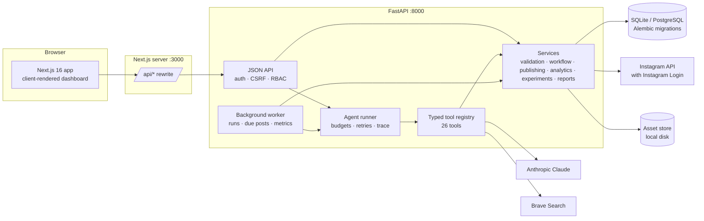
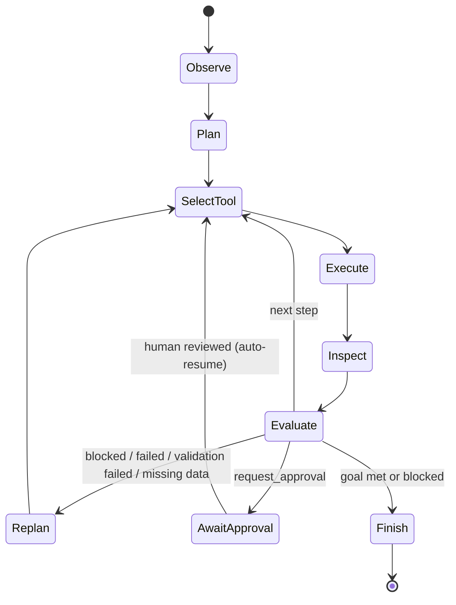
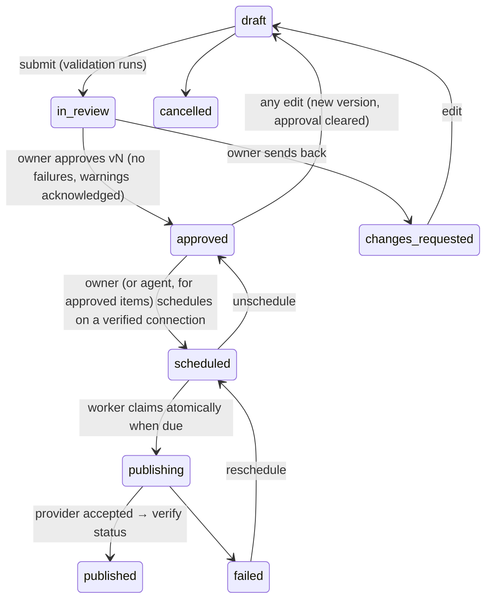

# Architecture

## Overview

* **One origin for the browser.** The frontend calls `/api/*` on its own origin; Next.js rewrites it to FastAPI.
  The session cookie stays HttpOnly and SameSite=Lax, with no CORS.
* **Backend owns all logic and secrets.** The frontend never sees credentials or tokens.
* **Worker.** A database-backed queue: agent runs and due publications are claimed with atomic `UPDATE … WHERE
  status=…`, so several workers can run safely. It runs in-process by default, or as `make worker`. Redis is
  optional and not required.

## Demo vs live separation

| | Demo | Live |
|---|---|---|
| Planner | `DemoPlanner` (deterministic state machine) | `LLMPlanner` (Claude tool use) |
| Content generation | `DemoGenerator` (catalogue-only templates) | `LLMGenerator` (Claude structured outputs) |
| Research | labelled fixtures + built-in seasonal calendar | Brave Search + public page fetch |
| Publishing adapters | `demo_instagram` (simulated) | `instagram`, `webhook` |
| Metrics | synthetic, labelled | Instagram insights or manual entry |
| Database | `data/demo.db` | `data/live.db` / `DATABASE_URL` |

The adapter registry exposes only mock adapters in demo mode and only real ones in live mode. Each database is
stamped with its mode on first use (`app_meta.mode`), and the app refuses a mismatch. Every fixture row carries
`is_synthetic`, every mock tool result carries `is_mock`, and the UI labels both.

## Agent

* **Run record (`agent_runs`):** id, goal, intent, planner, plan, working state, step count and limit, tokens used
  and budget, deadline, cancel flag, blockers, outcome and completion reason.
* **Steps (`agent_steps`):** phase (observe/plan/tool/evaluate/replan/decision/approval/finish), tool, input,
  output, status (ok/error/blocked), mock flag, attempt, duration, tokens. Each step is committed immediately, so
  the Command Centre polls real state.
* **Limits:** max tool steps, token budget, wall-clock timeout (all per workspace in Settings), cancellation, and
  bounded retries (2 extra attempts, exponential backoff) only for retryable errors.
* **Tools:** Pydantic input schemas with `extra="forbid"`. Invalid input becomes a recorded error step. Each tool
  has a permission level (`read`, `research`, `draft`, `approval`, `publish`). There is no shell, SQL or free-form
  network tool.
* **Human approval checkpoint:** `request_approval` pauses the run (`awaiting_approval`). When the last item it is
  waiting on is reviewed, the run auto-resumes, and `schedule_publication` only schedules items a person approved.
* **Demo planner branching** (all from real tool results):
  1. `search_web` blocked (demo / no key) → re-plan to the trend collector with labelled fixtures.
  2. No competitors → skip competitor analysis and continue on trend evidence.
  3. Validation failures → insert revise + re-validate steps (up to 2 rounds), then hold items for a person.
  4. No products → stop: factual content isn't possible.
  5. No metrics → skip comparison/evaluation and recommend what to measure.
* **Claude planner:** Claude picks tools in an append-only conversation stored on the run (so thinking blocks stay
  valid across the approval pause). It uses tool_choice `auto`, effort `medium` and the server-side refusal fallback.
  Tool results go back as `tool_result` blocks, errors as `is_error`. External content arrives wrapped as
  `<untrusted_content>`.

### Tools (26)

| Group | Tools |
|---|---|
| Context | `load_brand_context`, `retrieve_product_catalogue` |
| Research | `search_web`, `inspect_website`, `collect_trend_signals` |
| Competitors | `fetch_competitor_data`, `analyse_competitor_content`, `identify_content_gaps` |
| Planning | `generate_campaign_hypotheses`, `rank_campaign_opportunities`, `create_content_calendar` |
| Creative | `generate_content_brief`, `generate_caption`, `generate_image_asset` |
| Validation | `validate_product_claims`, `validate_brand_consistency`, `validate_platform_constraints` |
| Execution | `request_approval`, `schedule_publication`, `publish_content`, `verify_publication_status` |
| Learning | `collect_post_analytics`, `compare_content_performance`, `evaluate_experiment`, `revise_marketing_strategy`, `generate_campaign_report` |

Mocked parts are explicit: `collect_trend_signals` and `fetch_competitor_data` use fixtures in demo mode;
`generate_image_asset` makes labelled placeholders (no image provider is implemented); publishing tools use the
demo adapter in demo mode.

## Evidence model

`research_findings.classification`: `verified_observation` (fetched page content, our own data), `source_reported`
(search snippets, the seasonal calendar), `inference` (gap analysis), `hypothesis`, `unknown`. Each finding stores
`source_type`, `source_url`, `source_title`, `retrieved_at`, an excerpt and `is_synthetic`. Hypotheses link to
finding ids. Ranking uses a transparent weighted sum where evidence strength counts verified 3, source-reported 2
and inference 1 point, halved for synthetic. It is labelled as a heuristic, not a probability.

## Content lifecycle

* Every edit creates a `content_revisions` snapshot and increments `version`. Approval stores `approved_version`.
* Publishing re-checks at send time: approved version equals current version, validation passes, adapter allowed
  in this mode, and for live adapters `LIVE_PUBLISHING_ENABLED` plus `publish_authorized`.
* Successful publishes record idempotency key `<id>:v<version>` (unique), so a version is published at most once.
  Items stuck in `publishing` after a crash are failed for a human to check, never auto-republished.
* Duplicate prevention: the same final caption to the same account within 7 days can't be scheduled.
* Posts older than 6 hours past their slot are failed rather than published late.

## Data model (main tables)

`workspaces`, `users`, `memberships` (owner/editor/viewer), `user_sessions` (hashed tokens + CSRF token),
`invites`, `brands`, `personas`, `products`, `assets`, `research_findings`, `competitors`,
`competitor_observations`, `campaigns`, `hypotheses`, `experiments`, `recommendations`, `content_items`,
`content_revisions`, `channel_connections` (Fernet-encrypted credentials), `publish_attempts`, `metric_snapshots`
(nullable raw metrics: missing ≠ 0), `reports`, `agent_runs`, `agent_steps`, `oauth_states`, `audit_logs`,
`app_meta`. Migrations: `backend/migrations/` (Alembic; batch mode for SQLite).

## Analytics and experiments

* Raw metrics are stored as reported; `interactions` and `engagement_rate_by_reach` are derived and documented in
  the API (`definitions`) and the UI.
* Experiment evaluation: per-variant mean engagement rate by reach, a minimum sample per variant (default 3), a
  two-sided permutation test (4,000 permutations, seeded), and a stated screening threshold (p < 0.10) plus a lift
  criterion. Below the minimum sample the result is `inconclusive` and the experiment keeps running. Wording is
  association-only. Synthetic data is called out in every conclusion.

## Frontend

Next.js 16 App Router with Cache Components on. The dashboard is client-rendered behind a client-side session
check (`/api/auth/state`), so `(app)/layout.tsx` sets `instant = false` and instant-navigation validation is
limited to explicit opt-ins. Pages poll the API: the agent run page every 1.2 s while running. Charts use Recharts.
There is no `dangerouslySetInnerHTML`; reports render through a small Markdown-to-React renderer.
